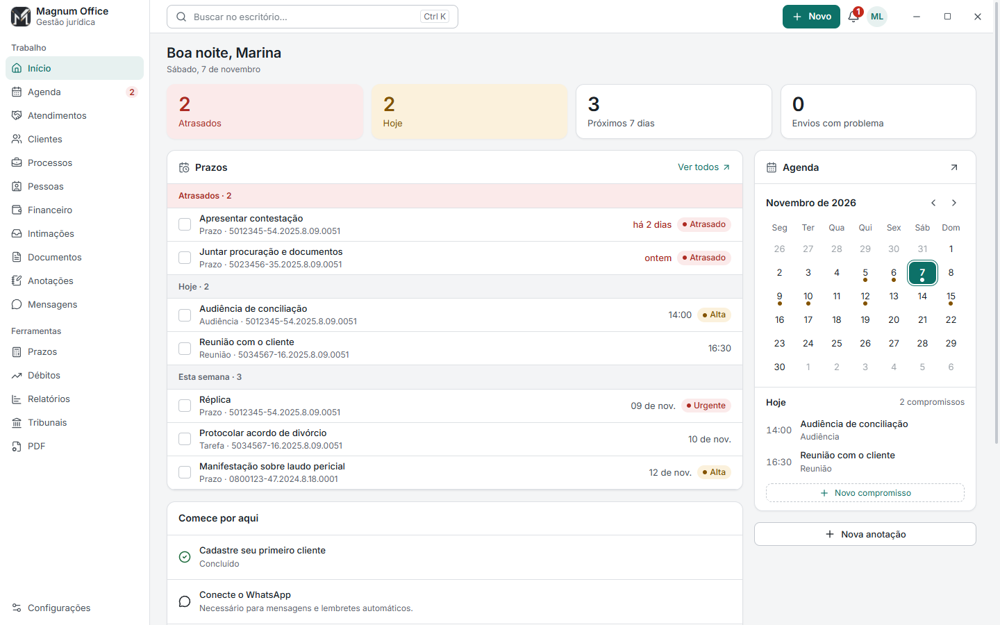
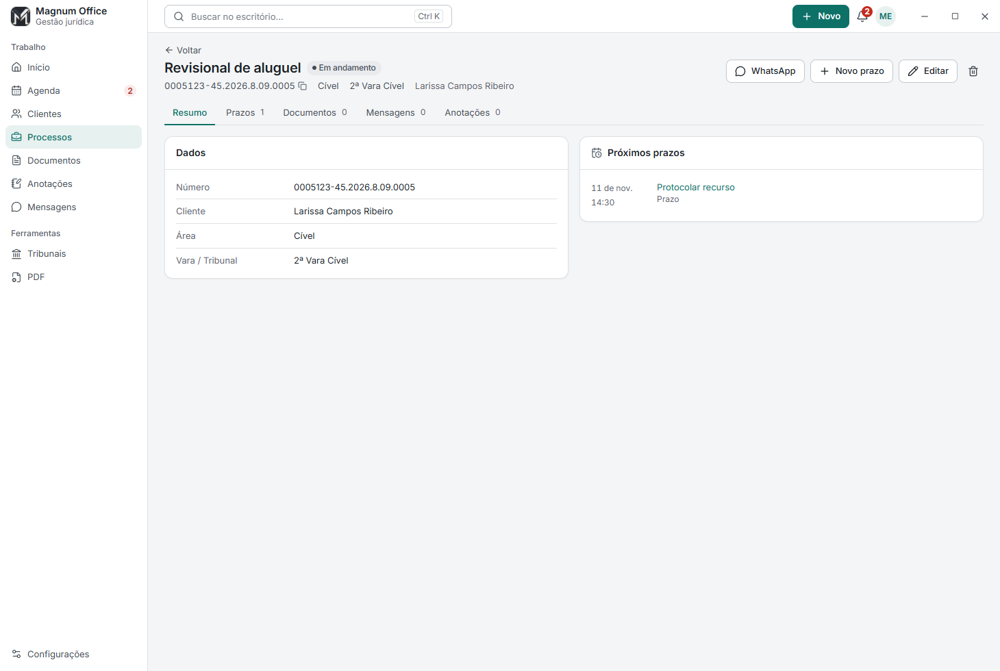
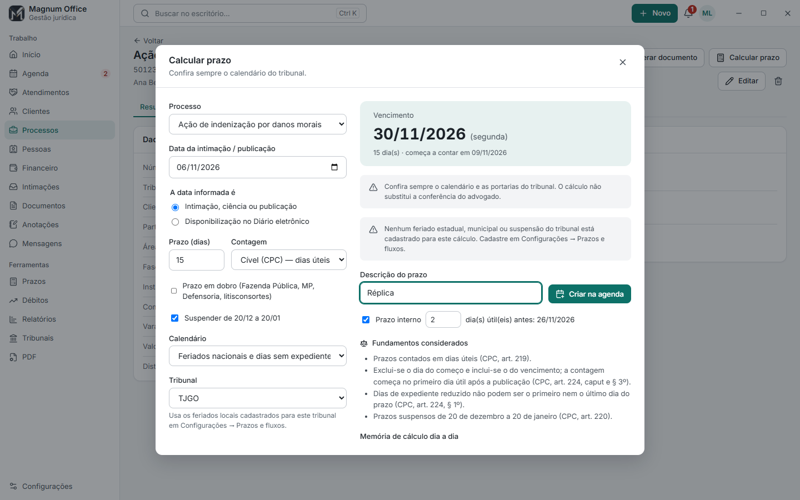
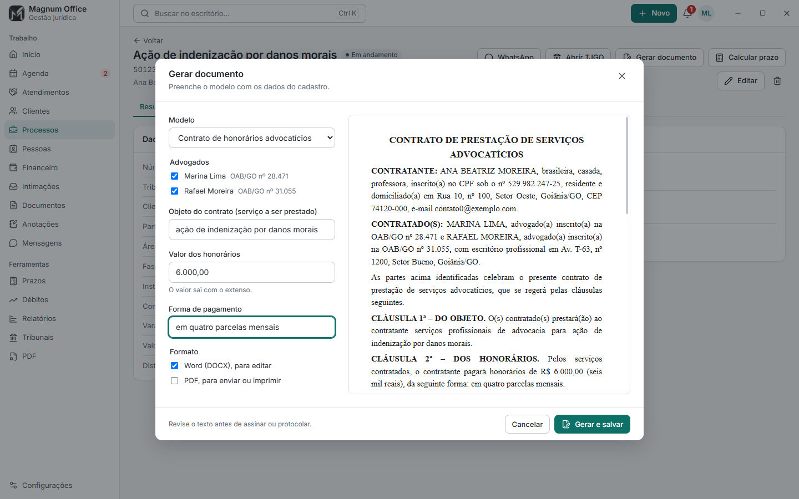
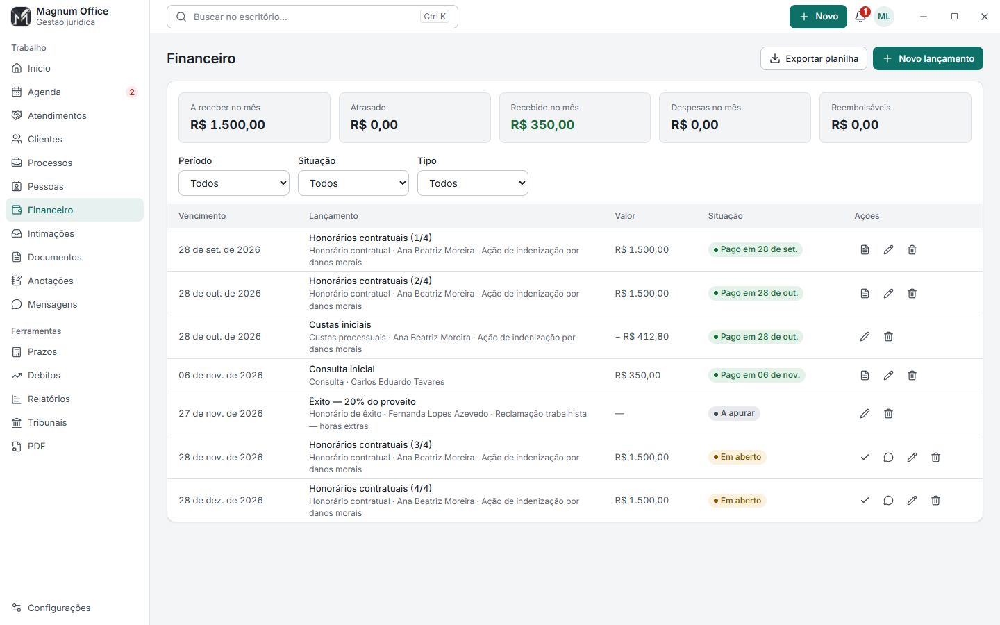
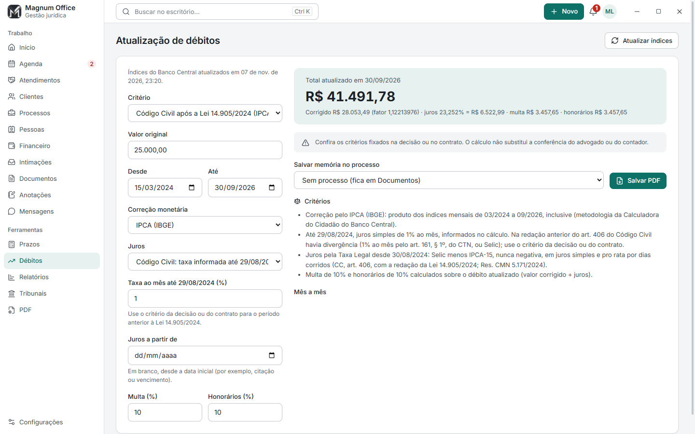
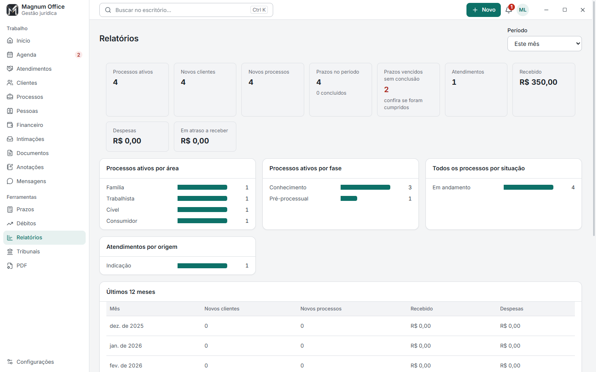
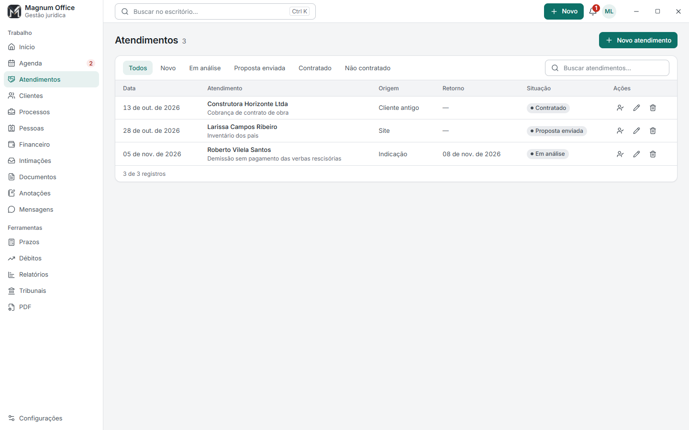
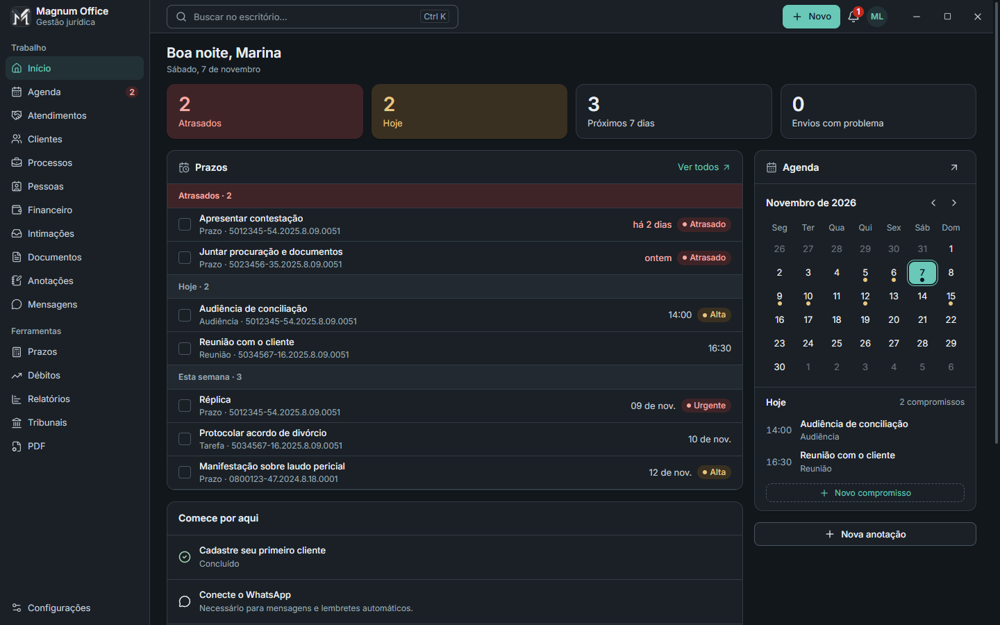

<div align="center">


# Magnum Office

**Gestão para escritórios de advocacia: gratuita, completa e com os dados no seu computador.**

Clientes, processos, prazos, documentos, financeiro, intimações, WhatsApp e e-mail em um só programa.<br />
Sem servidor, sem assinatura, sem mensalidade.

[](https://github.com/lucianumm/magnum-office/releases/latest)
[](https://github.com/lucianumm/magnum-office/releases)
[](https://github.com/lucianumm/magnum-office/actions/workflows/ci.yml)


[**Baixar**](https://github.com/lucianumm/magnum-office/releases/latest) · [Novidades](CHANGELOG.md) · [Instalação](docs/INSTALACAO.md) · [Atualizações](docs/ATUALIZACOES.md) · [Privacidade](docs/PRIVACIDADE.md) · [API/MCP](docs/API-MCP.md)



</div>

## Sumário

- [O que ele faz](#o-que-ele-faz)
- [Telas](#telas)
- [Instalar](#instalar)
- [Já usa o programa?](#já-usa-o-programa)
- [Primeiros passos](#primeiros-passos)
- [O que você precisa saber](#o-que-você-precisa-saber)
- [Tecnologias](#tecnologias)
- [Desenvolvimento](#desenvolvimento)
- [Histórico de versões](#histórico-de-versões)
- [Licença](#licença)

## O que ele faz

| | |
| --- | --- |
| **Processos** | Número CNJ conferido, com tribunal identificado e atalho para o portal. Partes, juízo, valor da causa, fase, segredo de justiça e processos relacionados. Andamentos, pessoas, documentos, prazos e financeiro em uma página só. Busca pelo número no DataJud e da empresa pelo CNPJ, quadro por fase, horas trabalhadas e alerta de prescrição. |
| **Clientes** | Qualificação completa, pronta para copiar, CPF e CNPJ conferidos (inclusive o alfanumérico) e aviso de conflito de interesses. |
| **Atendimentos** | Ficha de quem ainda não é cliente, com retorno agendado, e conversão em cliente e processo com um clique. |
| **Prazos** | Calculadora para CPC, CLT, Juizados e CPP, com feriados, recesso, prazo em dobro e memória de cálculo dia a dia. Calendário próprio do escritório por tribunal. |
| **Agenda** | Calendário e lista, audiência, perícia, reunião e diligência com confirmação e lembretes ao cliente por WhatsApp, fluxos de tarefas por tipo de ação e exportação para Google Agenda, Outlook ou celular. |
| **Documentos** | Procurações, contratos, declarações e recibos gerados em Word e PDF com os dados do cadastro, papel timbrado, fontes do Windows e numeração de páginas. Arquivos criptografados e busca dentro do texto dos documentos. Documentos digitalizados são lidos por OCR no próprio computador; perguntas com tipo e documento sem cadastro. |
| **Financeiro** | Honorários, parcelas, êxito, despesas reembolsáveis, recibo com valor por extenso, cobrança por WhatsApp e planilha. |
| **Cálculos** | Atualização de débitos por IPCA, INPC, IGP-M, IPCA-E, Selic e Taxa Legal (Lei 14.905/2024), com índices do Banco Central e memória em PDF. Rescisão com INSS e IRRF opcionais e liquidação trabalhista (horas extras, reflexos e ADC 58). |
| **Acompanhamento** | Andamentos pelo DataJud e intimações do Diário de Justiça Eletrônico Nacional, agrupadas por processo, com busca avulsa, certidão e atalho para calcular o prazo ou criar a audiência. Desligados por padrão. |
| **Relatórios** | Relatório ao cliente em linguagem simples e painel do escritório: processos, prazos, atendimentos e dinheiro. |
| **Comunicação** | WhatsApp por QR Code com modelos por finalidade, campanhas por data ou evento, regras de envio, respostas automáticas e andamento por CPF; e-mail com domínio próprio e campanhas; aniversários automáticos. |
| **Ferramentas** | PDF/A, união e divisão de PDF, diretório oficial de tribunais e importação de planilhas. Assinatura digital de PDF com certificado A1 (PAdES). |
| **Segurança** | Dados e documentos em AES-256-GCM, chave no cofre do Windows, backups semanais e portáteis, atualizações assinadas com retorno automático se algo falhar. Senha opcional do programa e lixeira de 30 dias. |
| **Agentes** | API local e servidor MCP, desligados por padrão, para usar o escritório com assistentes de IA de sua confiança. |

## Telas

<table>
  <tr>
    <td width="50%"><br /><b>Processo</b> — tudo do caso em uma página, com o tribunal identificado pelo número CNJ.</td>
    <td width="50%"><br /><b>Prazos</b> — vencimento com feriados e recesso, fundamentos e memória de cálculo.</td>
  </tr>
  <tr>
    <td><br /><b>Documentos</b> — contrato, procuração e recibo preenchidos com os dados do cadastro.</td>
    <td><br /><b>Financeiro</b> — parcelas, despesas, êxito a apurar, recibos e cobrança.</td>
  </tr>
  <tr>
    <td><br /><b>Débitos</b> — correção, juros, multa e honorários com índices do Banco Central.</td>
    <td><br /><b>Relatórios</b> — processos, prazos, atendimentos e dinheiro do período.</td>
  </tr>
  <tr>
    <td><br /><b>Atendimentos</b> — da primeira conversa ao contrato.</td>
    <td><br /><b>Tema escuro</b> — oito cores e modo escuro revisados para contraste.</td>
  </tr>
</table>

<sub>Todas as telas usam dados fictícios. Para gerar de novo: `node scripts/readme-screens.mjs`.</sub>

## Instalar

Abra o **PowerShell** e cole o bloco abaixo. Ele baixa a versão oficial, confere o SHA-256 informado pelo GitHub e abre o assistente. Não precisa de Node.js, npm ou Git.

```powershell
& {
    $ErrorActionPreference = 'Stop'
    if (-not [Environment]::Is64BitOperatingSystem) { throw 'Use Windows de 64 bits.' }
    $api = 'https://api.github.com/repos/lucianumm/magnum-office/releases/latest'
    $release = Invoke-RestMethod -Uri $api -Headers @{ 'User-Agent' = 'MagnumOffice-Installer'; Accept = 'application/vnd.github+json' }
    if ($release.draft -or $release.prerelease -or $release.tag_name -notmatch '^v(\d+\.\d+\.\d+)$') { throw 'Nenhuma versao oficial valida foi encontrada.' }
    $version = $Matches[1]
    $name = "advocacia-gestao-setup-$version-x64.exe"
    $assets = @($release.assets | Where-Object { $_.name -ceq $name })
    if ($assets.Count -ne 1 -or $assets[0].digest -notmatch '^sha256:[a-fA-F0-9]{64}$') { throw 'Instalador ou SHA-256 indisponivel. Baixe pela pagina oficial de releases.' }
    $expected = $assets[0].digest.Substring(7)
    $url = "https://github.com/lucianumm/magnum-office/releases/download/$($release.tag_name)/$name"
    if ($assets[0].browser_download_url -cne $url) { throw 'Origem do download nao autorizada.' }
    $folder = Join-Path ([IO.Path]::GetTempPath()) ('MagnumOffice-' + [Guid]::NewGuid().ToString('N'))
    New-Item -ItemType Directory -Path $folder | Out-Null
    $installer = Join-Path $folder $name
    Invoke-WebRequest -UseBasicParsing -Uri $url -OutFile $installer
    $stream = [IO.File]::OpenRead($installer)
    $hasher = [Security.Cryptography.SHA256]::Create()
    try { $actual = ([BitConverter]::ToString($hasher.ComputeHash($stream))).Replace('-', '') }
    finally { $stream.Dispose(); $hasher.Dispose() }
    if ($actual -ine $expected) {
        Remove-Item -LiteralPath $installer -Force
        throw 'O arquivo falhou na verificacao SHA-256. A instalacao foi interrompida.'
    }
    Write-Host 'Download verificado. Siga o assistente para instalar o Magnum Office.'
    Start-Process -FilePath $installer -Wait
}
```

Se preferir, baixe o `.exe` na [página de releases](https://github.com/lucianumm/magnum-office/releases/latest). Baixe somente do repositório oficial. [Veja o código da instalação](installers/quick-install.ps1).

O instalador ainda não possui certificado de editor Windows, então o Windows pode mostrar **"O Windows protegeu o computador"** com editor desconhecido. Confira se o arquivo veio da página oficial de releases e clique em **Mais informações → Executar assim mesmo**. O Smart App Control, onde estiver ativo, bloqueia o programa. A integridade é garantida pelo SHA-256 e, nas atualizações, pela assinatura Ed25519.

## Já usa o programa?

| Sua versão | Como atualizar |
| --- | --- |
| **1.9.0 ou mais nova** | O sistema procura e baixa sozinho e avisa quando estiver pronto. Você confirma a instalação, agora ou ao sair do programa. Se ela não concluir, use **Configurações → Atualizações → Instalar manualmente**. |
| **Versões anteriores** | Encerre por **Sair do sistema** na bandeja e use a [instalação rápida](#instalar) ou o instalador da última versão. |

Seus cadastros são preservados e uma cópia de segurança é feita antes de atualizar. Não desinstale o programa nem apague a pasta `%APPDATA%\AdvocaciaGestao`.

## Primeiros passos

1. Abra pelo atalho **Magnum Office** e aceite os termos.
2. Preencha a **configuração inicial**: nome, cidade e endereço do escritório, seu nome, os **advogados com OAB** (eles entram nas procurações e nos contratos), o nome exibido, a descrição, a logo e a cor. O sistema é liberado ao concluir, e tudo pode ser alterado depois em **Configurações → Escritório** e **Configurações → Personalizar**.
3. Em **Configurações → Escritório**, ligue **Iniciar com o Windows** para manter lembretes, envios e backups funcionando.
4. Cadastre clientes e processos ou use **Configurações → Importar dados**.
5. Em **Configurações → Prazos e fluxos**, cadastre os feriados locais dos tribunais em que você atua.
6. Em **Mensagens**, conecte o WhatsApp pelo QR Code. Em **Configurações → E-mail**, configure o domínio e o Resend, se for enviar e-mails.
7. Se quiser, ative em **Configurações → Consultas públicas** os andamentos do DataJud e as intimações do Diário de Justiça Eletrônico Nacional.
8. Em **Configurações → Backups e recuperação**, escolha a rotina de cópias, guarde uma cópia fora do computador e teste uma restauração.

## O que você precisa saber

- **Prazos e cálculos são ferramentas de apoio.** A calculadora mostra a memória de cálculo e os fundamentos, mas feriados locais, portarias e critérios da decisão precisam ser conferidos pelo advogado. Modelos de documentos são pontos de partida para revisar.
- **Envios automáticos dependem do programa aberto.** Mensagens, lembretes, consultas e backups só funcionam com o computador ligado e o programa aberto ou na bandeja. **Iniciar com o Windows**, em Configurações → Escritório, mantém tudo ativo depois de reiniciar.
- **O que sai do computador.** WhatsApp, Resend, DataJud, DJEN, Banco Central, GitHub e agentes são usados só quando você configura ou aciona. O DataJud recebe apenas números de processo; o DJEN, apenas OAB e UF; o Banco Central, apenas o código do índice. Veja a [política de privacidade](docs/PRIVACIDADE.md).
- **Exportações saem sem criptografia.** Planilhas, agenda `.ics` e cópias de documentos ficam onde você escolher, fora do cofre.
- **Perder os dados e todas as cópias pode ser irreversível.** Uma cópia portátil não pode ser recuperada sem a senha. Veja [backup e recuperação](docs/RECUPERACAO.md).
- **Backups entre computadores.** Backups locais dependem do cofre da mesma conta e do mesmo computador. Para outra máquina, use a cópia portátil ou a exportação legível. Chaves do Resend e sessão do WhatsApp precisam ser configuradas de novo, e disparos restaurados ficam em revisão.
- **PDF/A.** As páginas viram imagens de até 180 dpi: texto pesquisável, links, formulários e assinaturas digitais não são preservados nas cópias. Os originais ficam intactos.
- **Serviços externos.** WhatsApp (via Baileys, integração não oficial), Resend e serviços públicos podem ter limites, mudanças e custos próprios.

## Tecnologias

| Camada | Tecnologia |
| --- | --- |
| Aplicativo desktop | [Electron 44](https://www.electronjs.org/) com isolamento de contexto, sandbox, CSP e IPC por lista de comandos |
| Interface | [React 19](https://react.dev/) + [Vite 8](https://vite.dev/), CSS próprio com tokens, tema claro e escuro, fonte Inter local |
| Dados | SQLite nativo do Node 24 (`node:sqlite`), migrações com checksum e backup prévio |
| Segurança | AES-256-GCM, chave protegida pelo `safeStorage` do Windows, manifestos de atualização assinados com Ed25519 |
| Documentos | [pdf-lib](https://pdf-lib.js.org/), [PDFium](https://pdfium.googlesource.com/pdfium/) em WebAssembly, [mammoth](https://github.com/mwilliamson/mammoth.js), DOCX gerado pelo próprio sistema |
| Planilhas | [ExcelJS](https://github.com/exceljs/exceljs) e csv-parse |
| Comunicação | [Baileys](https://github.com/WhiskeySockets/Baileys) (WhatsApp) e [Resend](https://resend.com/) (e-mail) |
| Dados públicos | API Pública do DataJud (CNJ), Comunica PJe / DJEN (CNJ) e SGS do Banco Central |
| Agentes | [Model Context Protocol SDK](https://modelcontextprotocol.io/) e API REST local com [Zod](https://zod.dev/) |
| Qualidade | `node:test`, [Playwright](https://playwright.dev/) com Electron, ESLint, Prettier e GitHub Actions |
| Distribuição | [electron-builder](https://www.electron.build/) (NSIS), atualizador próprio com guardião e retorno automático |

```text
Electron
├── Interface React (sem Node.js, só comandos permitidos pelo preload)
└── Processo principal
    ├── SQLite + cofre AES-256-GCM (cadastros, documentos, texto indexado)
    ├── Prazos, fluxos, documentos, financeiro e cálculos
    ├── Fila de WhatsApp e e-mail, lembretes e aniversários
    ├── Consultas públicas (DataJud, DJEN, Banco Central) — desligadas por padrão
    ├── API local e MCP — desligados por padrão
    └── Backups e atualizador assinado com recuperação
```

Detalhes em [arquitetura](docs/ARQUITETURA.md).

## Desenvolvimento

Requisitos: Node.js 24, npm e Windows para gerar e testar o instalador.

```sh
npm ci
npm run check                 # lint, testes e build
node scripts/run-smokes.mjs   # testes da interface com o Electron
npm run test:update-e2e       # atualização e reversão com instaladores reais
npm run dev
```

Quer contribuir? Leia o [guia de contribuição](.github/CONTRIBUTING.md), o [código de conduta](.github/CODE_OF_CONDUCT.md) e a [política de segurança](.github/SECURITY.md).

`npm run test:update-e2e` gera instaladores reais e testa atualização e reversão em uma instalação separada, sem tocar na sua. `node scripts/readme-screens.mjs` refaz as imagens deste README com dados fictícios. Veja [arquitetura](docs/ARQUITETURA.md), [atualizações](docs/ATUALIZACOES.md), [publicação](docs/PUBLICACAO.md) e [API/MCP](docs/API-MCP.md).

## Histórico de versões

| Versão | Data | Destaques |
| --- | --- | --- |
| **1.12.0** | 13/11/2026 | Audiência e perícia com confirmação e lembretes por WhatsApp, campanhas, respostas automáticas e andamento por CPF, intimações por processo com busca avulsa, papel timbrado e fontes do Windows |
| 1.11.0 | 12/11/2026 | Lixeira, senha do programa, OCR, assinatura digital A1, liquidação trabalhista, horas por processo, quadro por fase, resumo diário, prescrição, CEP, importação de processos e Linux |
| 1.10.0 | 12/11/2026 | Atualização corrigida, perguntas separadas nos modelos, documento sem cadastro, busca por número do processo e CNPJ e calculadora de rescisão |
| 1.9.1 | 08/11/2026 | Configuração inicial obrigatória do escritório (advogados, identidade visual e logo) e arquivos de comunidade do projeto |
| 1.9.0 | 07/11/2026 | Calculadora de prazos, gerador de documentos, financeiro, atualização de débitos, DataJud, intimações do DJEN, atendimentos, relatórios, busca em documentos e novas ferramentas MCP |
| 1.3.0 | 06/11/2026 | Interface nova, página por cliente e processo, central de avisos, atualização automática com retomada e iniciar com o Windows |
| 1.2.0 | 06/11/2026 | Atualização manual forçada e campanhas de e-mail simplificadas |
| 1.1.0 | 06/11/2026 | Aniversários automáticos por WhatsApp e permanência na bandeja |
| 1.0.0 | 05/11/2026 | Primeira versão oficial |

Lista completa no [CHANGELOG](CHANGELOG.md).

## Me pague um café ☕

Projeto independente e sem custo. Todos os recursos continuam disponíveis sem contribuição. Confira o recebedor no seu banco antes de concluir.


## Licença

**É proibido comercializar, vender, revender ou cobrar pela licença ou pelo acesso ao próprio sistema.** O uso profissional gratuito no escritório é permitido. A licença é própria, conforme [LICENSE](LICENSE). Dependências de terceiros mantêm suas próprias licenças.

GitHub: [lucianumm](https://github.com/lucianumm) · Instagram: [@lucianum](https://www.instagram.com/lucianum/)
